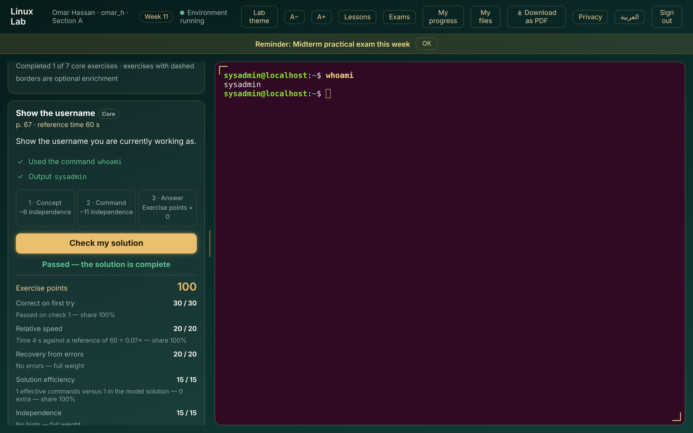
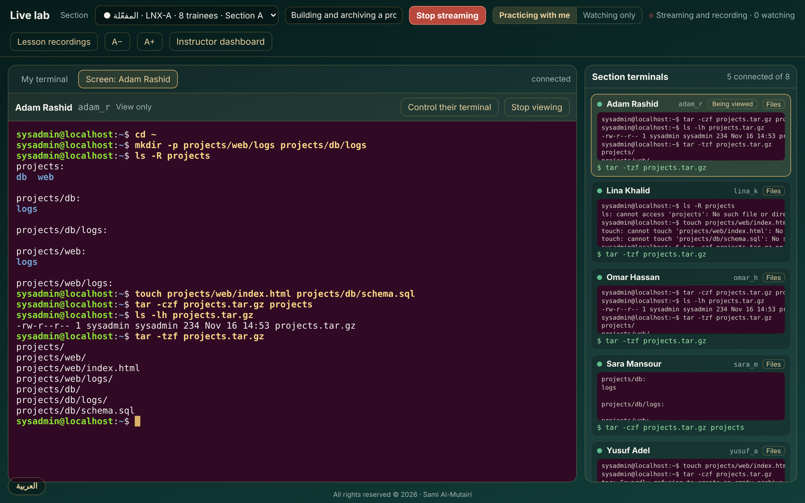
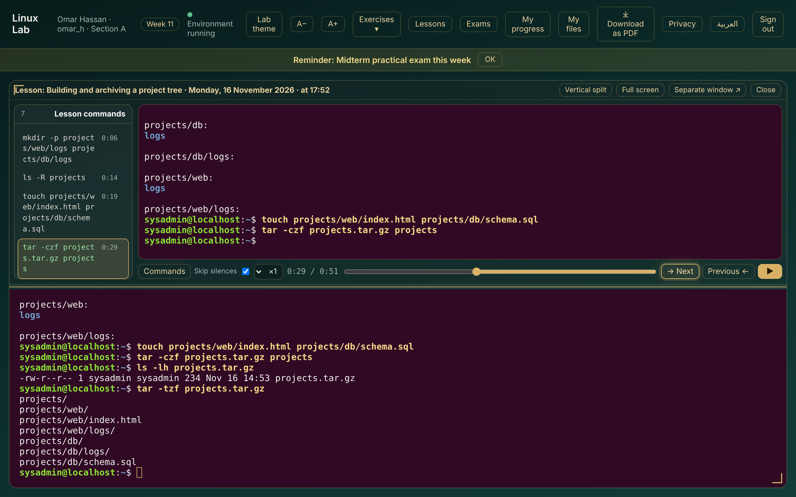
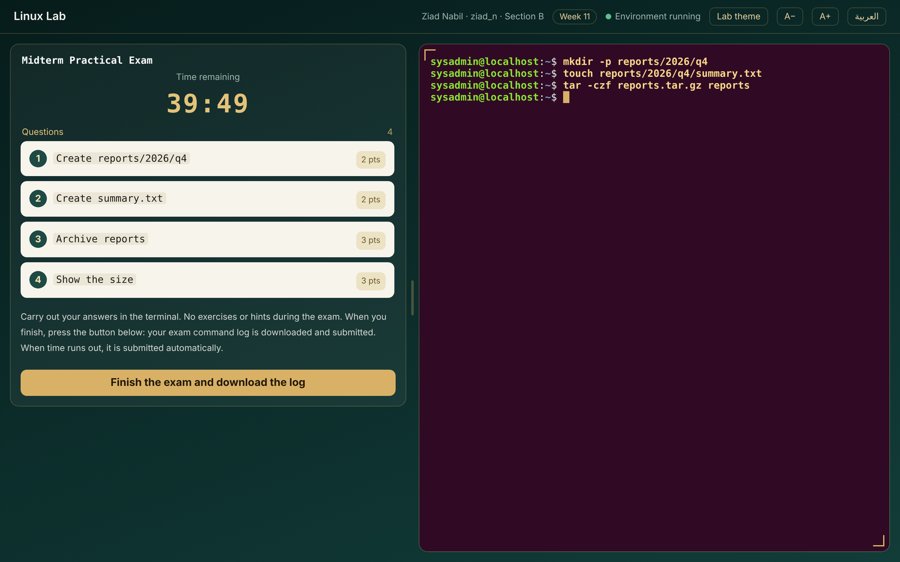
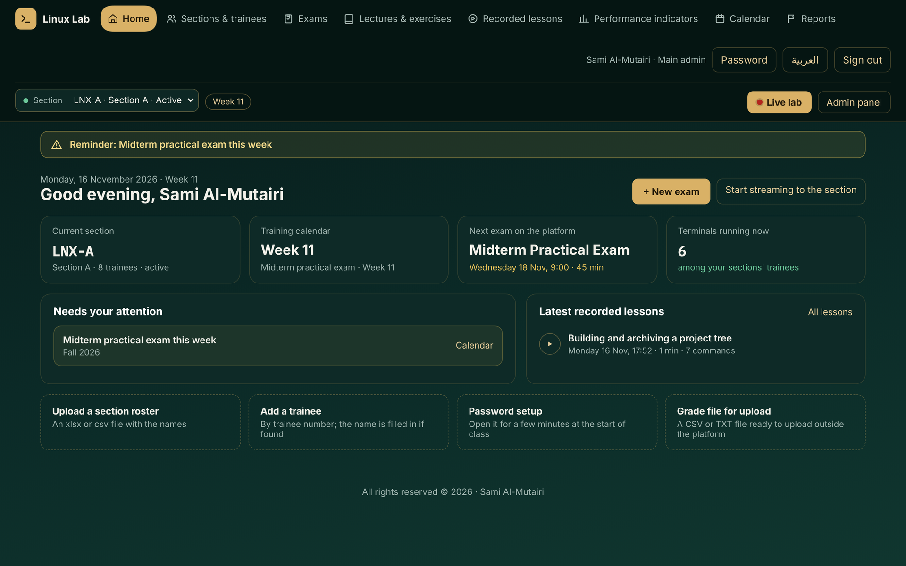

# Linux Lab

**A real Linux system for every trainee, right in the browser.**

Linux Lab is a bilingual Arabic and English training platform for a Linux command-line course. Each trainee works in an isolated Ubuntu container, follows recorded lessons step by step, and takes timed practical exams that are graded automatically.

**[View the project page →](https://YOUR-USERNAME.github.io/linux-lab-showcase/)**

> This repository presents the project and its results. The source code is private and is not published here. All screenshots show the English interface with demo accounts, not real trainee data.

| | |
|---|---|
|  |  |
|  |  |

## In use

| Trainees | Class sections | Lab sessions | Commands logged | Exam sessions |
|---:|---:|---:|---:|---:|
| 103 | 6 | 1,317 | 41,505 | 152 |

*Figures as of November 2026, the middle of the first semester in use.*

## Highlights

- **Real Ubuntu containers** for every trainee, opened with one click from any computer.
- **Recorded lessons** that replay the instructor's terminal so trainees can follow along.
- **Live monitoring** of every trainee terminal during class.
- **Auto-graded practical exams** that check what the trainee actually ran, with PDF grade sheets and a CSV export.
- **Progress indicators** for lesson adherence and command accuracy, compared with an anonymous class average.
- **Arabic and English** interfaces, switchable per user.
- **Privacy and security by design**: minimal personal data, a published privacy policy, hardened containers, and a full security review.

## Built with

Python · FastAPI · SQLite · Docker (rootless) · xterm.js · WebSocket · Caddy · Ubuntu

## About

Designed, built, and operated by **Sami Al-Mutairi**, a computer and information technology trainer, to teach the practical side of his operating systems course.
